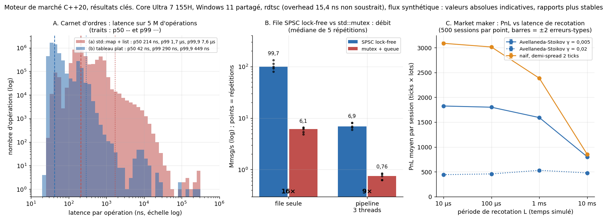
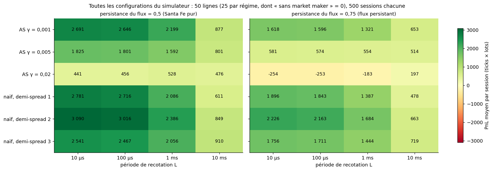
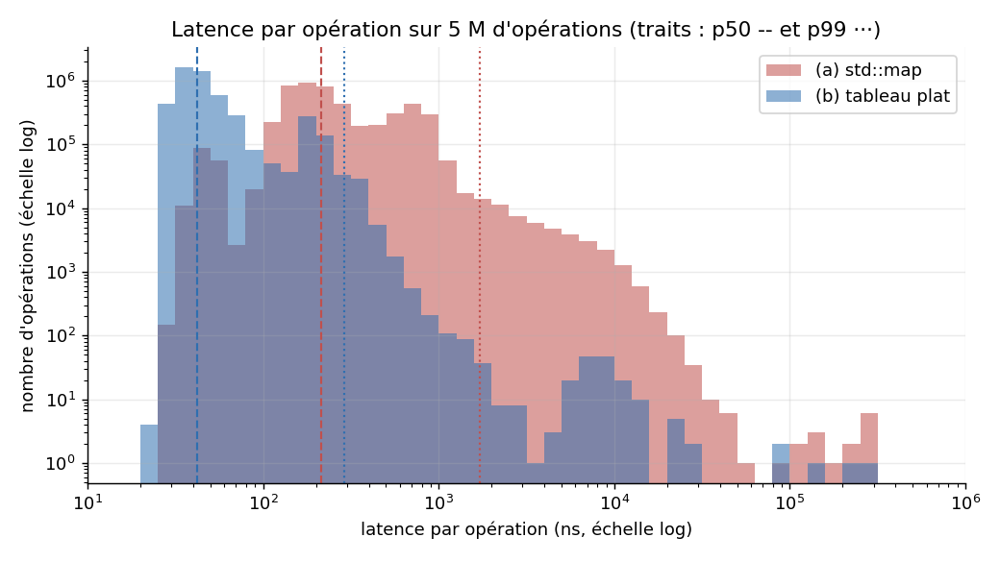
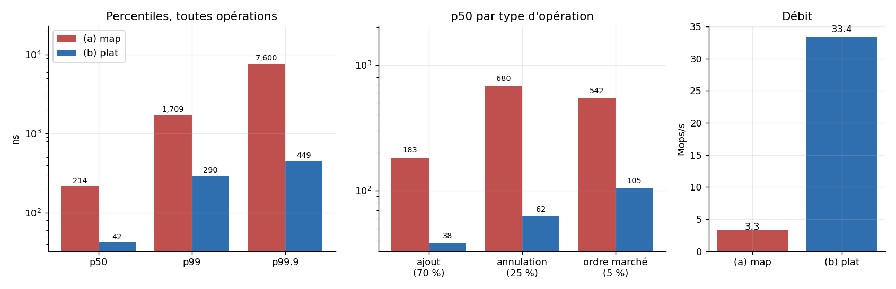
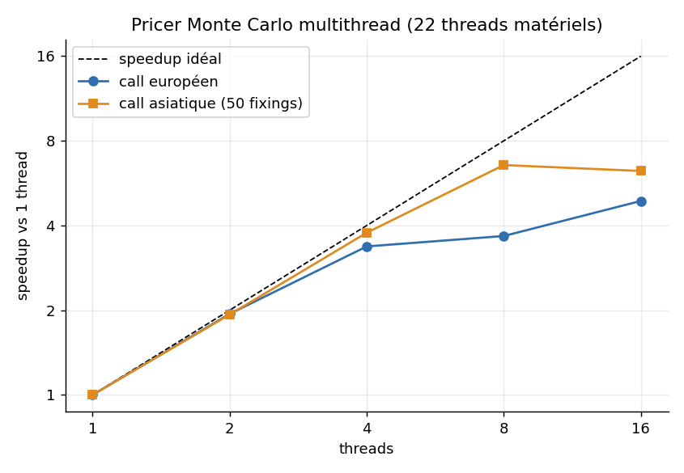
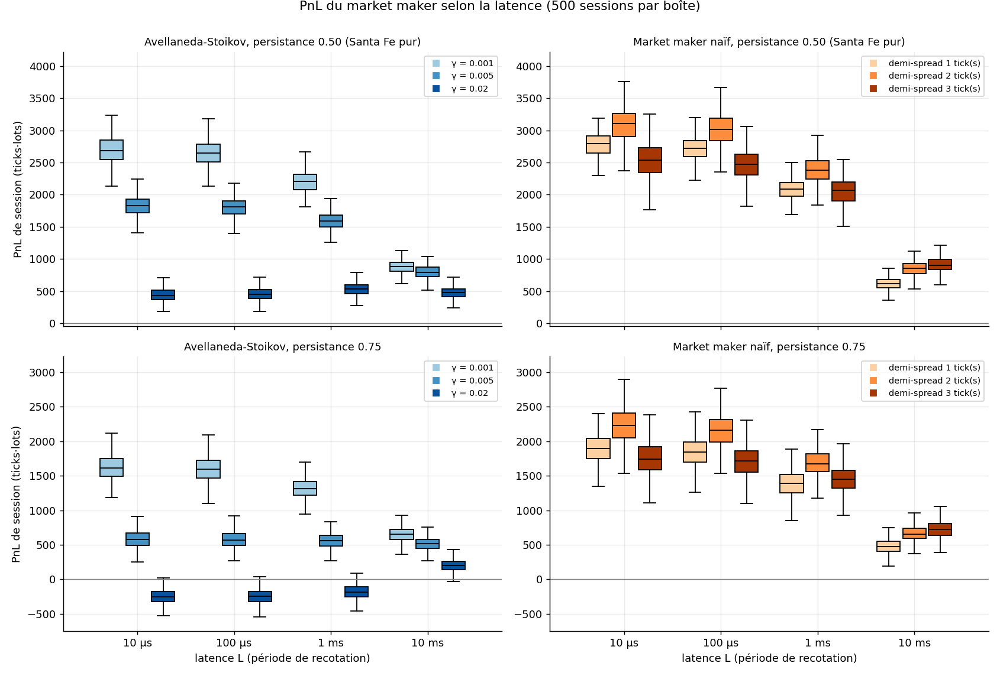
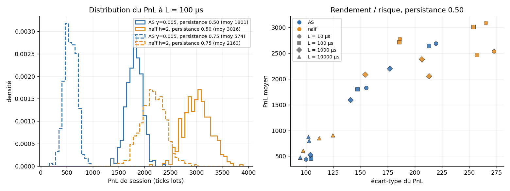
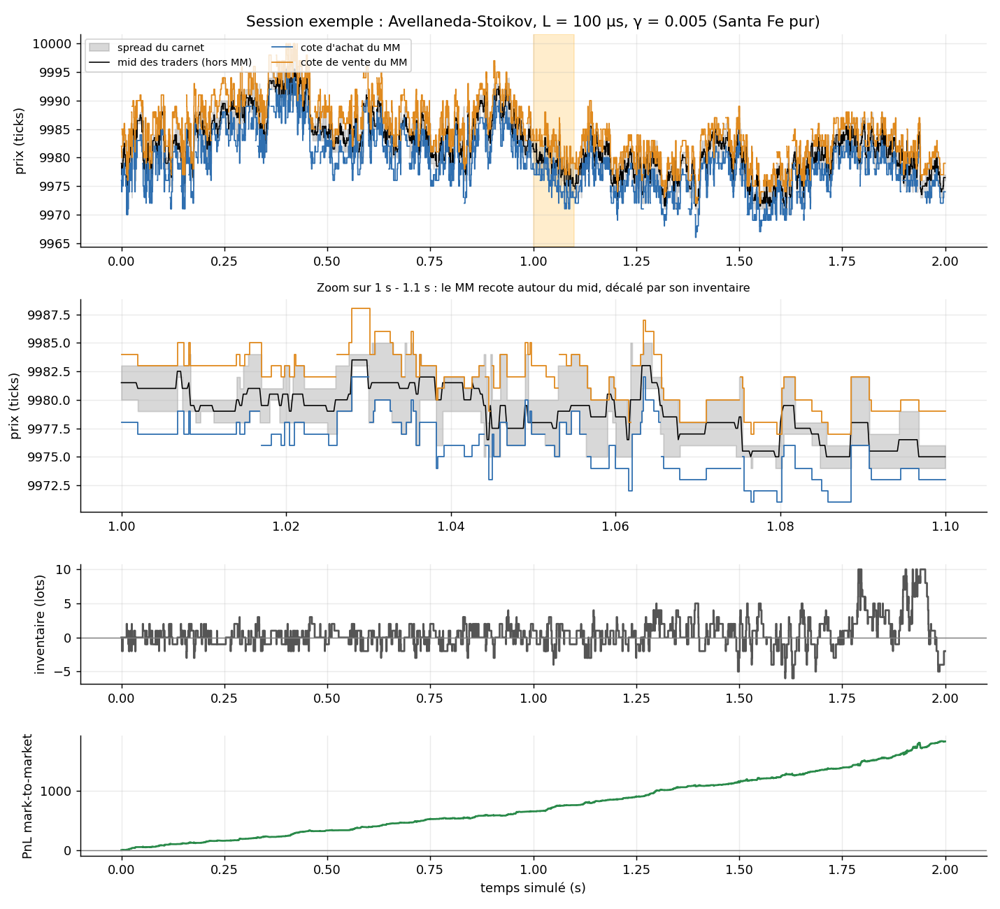
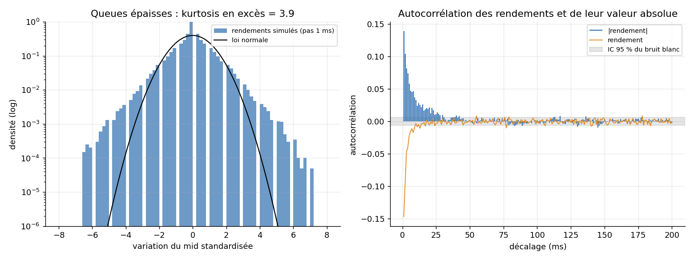
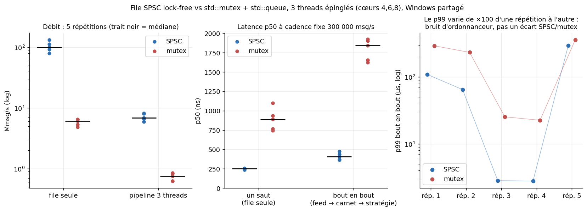

# Moteur de marché C++20 : carnet d'ordres, latence, file lock-free, market maker, pricer Monte Carlo

Un petit moteur de marché en **C++20 sans dépendance** : deux carnets d'ordres à priorité prix-temps (`std::map` contre tableau plat) comparés au p50 / p99 / p99,9 et testés l'un contre l'autre, une file SPSC lock-free contre `std::mutex` dans un pipeline feed → carnet → stratégie, un simulateur multi-agents avec market maker Avellaneda-Stoikov, et un pricer Monte Carlo multithread. Chaque chiffre est lu dans `results/*.json`, avec ses hypothèses de mesure juste en dessous.

*A dependency-free C++20 market engine: two price-time order books (`std::map` vs flat array) benchmarked at p50/p99/p99.9 and tested differentially, a lock-free SPSC queue vs `std::mutex` in a 3-thread pipeline, a multi-agent simulator with an Avellaneda-Stoikov market maker, and a multithreaded Monte Carlo pricer.*

<!-- BEGIN:badges -->


<!-- END:badges -->

## Hypothèses de mesure

À lire avant tout chiffre : les latences sont **brutes** (overhead de mesure non soustrait), prises sur une **machine Windows partagée**, et le flux d'ordres est **synthétique**. Les valeurs absolues dépendent de la machine ; les rapports sont plus stables.

<!-- BEGIN:hypotheses -->
| Hypothèse de mesure | Valeur |
|---|---|
| Machine | Intel Core Ultra 7 155H (16 cœurs, 22 threads logiques, hybride P/E), Windows 11. **Machine de travail partagée**, pas un serveur isolé : d'autres processus tournent pendant les mesures. |
| Compilateur | g++ 16.2.0 (MinGW-w64), `-O3 -march=native -std=c++20`. La CI Linux (g++ ≥ 13) compile et exécute les tests, pas les benchmarks. |
| Horloge | `rdtsc` encadré de `lfence`, TSC calibré à 2,995 GHz sur `steady_clock` (granularité 100 ns, plus grosse que l'opération mesurée). |
| Overhead de mesure | 15,4 ns par mesure, mesuré et **non soustrait** : toutes les latences sont brutes. |
| Épinglage | Carnet : thread sur le cœur logique 14, priorité du processus relevée. SPSC / pipeline : cœurs 4, 6, 8. Hors Windows : pas d'épinglage. |
| Flux du benchmark | 5 000 000 opérations mesurées après 500 000 de chauffe (70 % ajouts, 25 % annulations, 5 % ordres au marché), ≈ 50 114 ordres vivants, graine 20260101. Le même flux est rejoué sur les deux carnets. |
| Répétitions | Carnet : 3, alternées (a, b, a, b…) ; on publie la répétition de p50 médian. SPSC : 5, médiane ; latences à cadence fixe de 300 000 msg/s. |
| Variabilité connue | Valeurs absolues : facteur 1,6 d'une exécution à l'autre sur cette machine ; rapport p50 map / plat : 4,7 à 5,1× sur toutes les exécutions faites. Les `max` et les queues p99/p99,9 du SPSC et du mutex sont du bruit d'ordonnanceur. |
| Pas mesuré | Compteurs matériels (défauts de cache), ThreadSanitizer (absent de ce MinGW), réseau (aucun), données de marché réelles (flux synthétique). |
<!-- END:hypotheses -->

## Tableau des métriques

Tous les nombres sont lus dans `results/*.json` et `results/resume_pnl.csv` par `analyse/vitrine_05.py`.

<!-- BEGIN:metriques -->
| Carnet, 5 M opérations | p50 | p99 | p99,9 | max | débit |
|---|--:|--:|--:|--:|--:|
| (a) `std::map` + `std::list` | 214 ns | 1,7 µs | 7,6 µs | 291 µs | 3,26 Mops/s |
| (b) tableau plat indexé par tick | 42 ns | 290 ns | 449 ns | 254 µs | 33,4 Mops/s |
| **rapport (a) / (b)** | **5,1×** | **5,9×** | **16,9×** | interruptions OS | **10,2×** |

| File SPSC vs mutex | SPSC lock-free | `std::mutex` + `std::queue` | rapport |
|---|--:|--:|--:|
| Débit, file seule (20 M entiers) | 99,7 Mmsg/s | 6,1 Mmsg/s | 16× |
| Débit, pipeline 3 threads (4 M ordres) | 6,9 Mmsg/s | 0,76 Mmsg/s | 9× |
| Latence d'un saut, p50 / p99 / p99,9 | 251 ns / 7,4 µs / 1,79 ms | 889 ns / 26,6 µs / 1,13 ms | p50 : 3,5× |
| Latence bout en bout, p50 / p99 / p99,9 | 406 ns / 64,8 µs / 923 µs | 1,8 µs / 233 µs / 1,31 ms | p50 : 4,5× |

| Pricer Monte Carlo (GBM) | estimation ± erreur-type | référence | écart |
|---|--:|---|---|
| Call européen (20 M couples antithétiques) | 8,91612 ± 0,00167 | Black-Scholes 8,91604 | 0,05 erreur-type |
| Call asiatique géométrique (validation) | 4,93494 ± 0,00395 | forme fermée 4,94185 | -1,75 erreur-type |
| Call asiatique arithmétique (50 fixings) | 5,12250 ± 0,00407 | aucune forme fermée | voir géométrique |
| Speedup à 16 threads (européen / asiatique) | 4,89× / 6,25× | idéal 16× | CPU hybride, 22 threads logiques |

| Market maker, PnL moyen par session (ticks × lots), flux pur | 10 µs | 100 µs | 1 ms | 10 ms | 10 µs → 10 ms |
|---|--:|--:|--:|--:|--:|
| AS γ = 0,005 | 1 825 | 1 801 | 1 592 | 801 | -56 % |
| naïf, demi-spread 2 ticks | 3 090 | 3 016 | 2 386 | 849 | -73 % |
<!-- END:metriques -->

## Figure héro



**Comment lire ce graphique.** **A**, histogramme des latences de chaque opération sur 5 M d'opérations (axes en log) : le tableau plat (bleu) est décalé vers la gauche et a une queue bien plus courte que `std::map` (rouge). **B**, débit de la file SPSC (bleu) contre la file `std::mutex` (rouge) seule puis dans le pipeline à 3 threads ; les points noirs sont les 5 répétitions, le chiffre en gras est le rapport. **C**, PnL moyen d'un market maker simulé selon sa période de recotation : plus il recote lentement, moins il gagne.

## Les chiffres sont-ils fiables ? Lecture en 30 secondes

<!-- BEGIN:lecture30 -->
- **Correct ?** Les deux carnets produisent exactement les mêmes trades, dans le même ordre, sur 1 200 000 opérations aléatoires : 0 désaccord, 0 incohérence ; 134 + 162 vérifications, 0 échec (sortie dans `results/log_tests.txt`). Le pipeline à 3 threads rend le même carnet final que l'exécution mono-thread, file SPSC comme file mutex.
- **Rapide ?** Le rapport p50 est de 5,1× et le débit de 10,2× ; les valeurs absolues bougent d'un facteur 1,6 selon le cœur et la charge de la machine, le rapport reste dans 4,7-5,1× sur le p50. Pour le SPSC, seuls le p50 et le débit départagent : le p99 bout en bout va de 2,8 µs à 294 µs d'une répétition à l'autre.
- **Utile ?** Dans le simulateur, passer d'une recotation toutes les 10 µs à toutes les 10 ms fait perdre 56 % de PnL à l'Avellaneda-Stoikov (γ = 0,005). Le marché est synthétique et non calibré : c'est un mécanisme illustré, pas une rentabilité.
<!-- END:lecture30 -->

## Toutes les variantes

Rien n'est écarté : toutes les configurations mesurées sont ci-dessous, y compris celles où l'Avellaneda-Stoikov perd de l'argent ou où le speedup plafonne.



**Comment lire ce graphique.** Chaque case est une configuration du simulateur (une stratégie en ligne, une période de recotation L en colonne) ; le chiffre est le PnL moyen de 500 sessions et la couleur va du rouge (perte) au vert (gain). À gauche le flux pur, à droite le flux persistant : on voit le PnL baisser partout quand L augmente, et la ligne « AS γ = 0,02 » devenir négative quand le flux est persistant.

<!-- BEGIN:variantes -->
**Carnets : 2 structures × 4 types d'opération** (`results/bench_carnet.json`)

| Carnet | Opération | n | p50 | p99 | p99,9 | max | moyenne |
|---|---|--:|--:|--:|--:|--:|--:|
| (a) `std::map` | **toutes** | 5 000 000 | 214 ns | 1,7 µs | 7,6 µs | 291 µs | 365 ns |
| (a) `std::map` | ajout | 3 498 663 | 183 ns | 493 ns | 1,2 µs | 291 µs | 199 ns |
| (a) `std::map` | annulation | 1 251 118 | 680 ns | 1,2 µs | 2,5 µs | 251 µs | 672 ns |
| (a) `std::map` | marche | 250 219 | 542 ns | 9,3 µs | 17,0 µs | 253 µs | 1,1 µs |
| (b) tableau plat | **toutes** | 5 000 000 | 42 ns | 290 ns | 449 ns | 254 µs | 62 ns |
| (b) tableau plat | ajout | 3 498 663 | 38 ns | 90 ns | 186 ns | 254 µs | 41 ns |
| (b) tableau plat | annulation | 1 251 118 | 62 ns | 347 ns | 481 ns | 211 µs | 107 ns |
| (b) tableau plat | marche | 250 219 | 105 ns | 467 ns | 839 ns | 22,2 µs | 131 ns |

Les trois répétitions alternées (on publie celle de p50 médian) :

| Carnet | débit par répétition (Mops/s) | p50 par répétition (ns) |
|---|---|---|
| (a) `std::map` | 3,23, 3,53, 3,26 | 218,3, 208,3, 213,7 |
| (b) tableau plat | 27,98, 33,79, 33,41 | 42,1, 42,1, 42,1 |

**File SPSC vs mutex : 2 files × (débit, latence) × (file seule, pipeline)** (`results/bench_spsc.json`)

| File | Mesure | Médiane de 5 rép. | Min à max des répétitions (p50 ou débit) | Queue p99 (médiane, étendue) | Extrêmes |
|---|---|---|---|---|---|
| SPSC lock-free | débit, file seule | 99,74 Mmsg/s | 79,38 à 133,47 Mmsg/s |  |  |
| SPSC lock-free | débit, pipeline 3 threads | 6,87 Mmsg/s | 5,95 à 8,13 Mmsg/s |  |  |
| SPSC lock-free | latence, un saut, file seule | p50 251 ns | 235 ns à 256 ns | p99 7,4 µs (de 947 ns à 253 µs) | p99,9 1,79 ms, max 3,77 ms |
| SPSC lock-free | latence, bout en bout (pipeline) | p50 406 ns | 367 ns à 472 ns | p99 64,8 µs (de 2,8 µs à 294 µs) | p99,9 923 µs, max 1,66 ms |
| `std::mutex` + `std::queue` | débit, file seule | 6,08 Mmsg/s | 4,84 à 6,55 Mmsg/s |  |  |
| `std::mutex` + `std::queue` | débit, pipeline 3 threads | 0,76 Mmsg/s | 0,63 à 0,85 Mmsg/s |  |  |
| `std::mutex` + `std::queue` | latence, un saut, file seule | p50 889 ns | 742 ns à 1,1 µs | p99 26,6 µs (de 11,6 µs à 236 µs) | p99,9 1,13 ms, max 3,06 ms |
| `std::mutex` + `std::queue` | latence, bout en bout (pipeline) | p50 1,8 µs | 1,6 µs à 1,9 µs | p99 233 µs (de 22,6 µs à 360 µs) | p99,9 1,31 ms, max 2,43 ms |

**Pricer Monte Carlo : 5 nombres de threads × 2 produits** (`results/mc_pricer.json`)

| threads | européen : temps | speedup | asiatique : temps | speedup | efficacité asiatique |
|--:|--:|--:|--:|--:|--:|
| 1 | 0,776 s | 1,00× | 1,914 s | 1,00× | 1,00 |
| 2 | 0,400 s | 1,94× | 0,990 s | 1,93× | 0,97 |
| 4 | 0,230 s | 3,37× | 0,508 s | 3,77× | 0,94 |
| 8 | 0,211 s | 3,67× | 0,292 s | 6,56× | 0,82 |
| 16 | 0,159 s | 4,89× | 0,306 s | 6,25× | 0,39 |

**Simulateur : 25 configurations, flux pur (persistance 0,50, Santa Fe).** PnL moyen par session (ticks × lots) ; erreur-type de la moyenne de 4 à 12 (500 sessions par ligne)

| Stratégie | 10 µs | 100 µs | 1 ms | 10 ms |
|---|--:|--:|--:|--:|
| sans market maker | 0 | 0 | 0 | 0 |
| AS γ = 0,001 | 2 691 | 2 646 | 2 199 | 877 |
| AS γ = 0,005 | 1 825 | 1 801 | 1 592 | 801 |
| AS γ = 0,02 | 441 | 456 | 528 | 476 |
| naïf, demi-spread 1 | 2 781 | 2 716 | 2 086 | 611 |
| naïf, demi-spread 2 | 3 090 | 3 016 | 2 386 | 849 |
| naïf, demi-spread 3 | 2 541 | 2 467 | 2 056 | 910 |

Détail à L = 100 µs :

| Stratégie | PnL moyen | écart-type | inventaire max moyen (lots) | trades par session |
|---|--:|--:|--:|--:|
| AS γ = 0,001 | 2 646 | 213 | 9,9 | 1 055 |
| AS γ = 0,005 | 1 801 | 147 | 9,1 | 941 |
| AS γ = 0,02 | 456 | 105 | 7,4 | 725 |
| naïf, demi-spread 1 | 2 716 | 185 | 10,0 | 1 910 |
| naïf, demi-spread 2 | 3 016 | 254 | 10,0 | 1 190 |
| naïf, demi-spread 3 | 2 467 | 257 | 10,0 | 722 |

**Simulateur : 25 configurations, flux persistant (persistance 0,75).** PnL moyen par session (ticks × lots) ; erreur-type de la moyenne de 4 à 12 (500 sessions par ligne)

| Stratégie | 10 µs | 100 µs | 1 ms | 10 ms |
|---|--:|--:|--:|--:|
| sans market maker | 0 | 0 | 0 | 0 |
| AS γ = 0,001 | 1 618 | 1 596 | 1 321 | 653 |
| AS γ = 0,005 | 581 | 574 | 554 | 514 |
| AS γ = 0,02 | -254 | -253 | -183 | 197 |
| naïf, demi-spread 1 | 1 896 | 1 843 | 1 387 | 478 |
| naïf, demi-spread 2 | 2 226 | 2 163 | 1 684 | 663 |
| naïf, demi-spread 3 | 1 756 | 1 711 | 1 444 | 719 |

Détail à L = 100 µs :

| Stratégie | PnL moyen | écart-type | inventaire max moyen (lots) | trades par session |
|---|--:|--:|--:|--:|
| AS γ = 0,001 | 1 596 | 190 | 10,0 | 918 |
| AS γ = 0,005 | 574 | 121 | 9,4 | 726 |
| AS γ = 0,02 | -253 | 106 | 7,8 | 470 |
| naïf, demi-spread 1 | 1 843 | 216 | 10,0 | 1 640 |
| naïf, demi-spread 2 | 2 163 | 241 | 10,0 | 974 |
| naïf, demi-spread 3 | 1 711 | 237 | 10,0 | 562 |
<!-- END:variantes -->

## Pourquoi ce projet

Fil rouge du portfolio : à coûts réels, l'avantage d'un desk ne se trouve pas dans un signal mais dans la fourniture de liquidité et dans l'exécution. Ce moteur est la brique « vérifiable et mesurée » de cette chaîne.

- **Xrays Trading** (automates de market making, et simulateur qui teste les automates face aux marchés, d'après la page stage du site) : un carnet testé en différentiel, un market maker analytique face à des traders zéro-intelligence, et la question que se pose tout automate : combien coûte une recotation tardive ?
- **smartTrade** (plateforme de trading FX multi-actifs : pricing, agrégation de liquidité) : mesurer ce que coûte une structure de données par opération, séparer latence et débit, et écrire une file inter-threads **correcte** avant de la vouloir rapide.

Je n'ai vu ni leur code ni leurs systèmes : le rapprochement est conceptuel. Ce dépôt n'est pas un système de production : pas de réseau, pas de FIX ni d'ITCH, un seul instrument.

## Architecture

```
                      +------------------------------ include/carnet.hpp, src/carnet.cpp ---------------------------+
                      |  API commune (par template, sans virtuel) :                                                  |
                      |  ajouter_limite | annuler | modifier | ordre_marche  ->  journal de Trade (maker, taker, prix, qte)|
                      |                                                                                              |
                      |  (a) CarnetMap                         (b) CarnetPlat                                        |
                      |   std::map<prix, std::list<ordre>>      niveaux[prix - base] (16 o) + bitmap des niveaux     |
                      |   unordered_map<id, iterateur>          pool d'ordres contigu, chaînage par indices          |
                      |                                         table id -> slot (indexation directe)                |
                      +-------------+--------------------------------+---------------------+-------------------------+
                                    |                                |                     |
                  tests/test_carnet.cpp                bench/bench_carnet.cpp        src/simulateur.cpp  (utilise (b))
                  - scénarios (FIFO, partiel,          - flux 70/25/5 généré une     - traders ZI Poisson (limites, marché,
                    croisement, balayage, modif)         fois, rejoué sur (a) et (b)     annulations par ordre vivant)
                  - différentiel (a) = (b) sur         - latence/op par rdtsc          - market maker AS  /  naïf  /  aucun
                    1 M ops + comptabilité             - débit hors chronomètre        - 500 sessions Monte Carlo, N threads
                         |                                      |                              |
                         v                                      v                              v
                    code retour 0/1               results/bench_carnet.json      results/sessions.csv, trajectoire.csv,
                                                                                  serie_mid.csv, simulateur_meta.json

   src/mc_pricer.cpp (indépendant) : GBM, antithétiques, 1 générateur par thread  ->  results/mc_pricer.json

   analyse/analyse.py : lit results/*  ->  figures/fig1..fig7 (PNG, 130 dpi) + results/resume_pnl.csv
```

## Choix de conception

**Prix en ticks entiers.** Un prix est un `int32_t` en nombre de ticks, jamais un `double` : l'égalité de deux niveaux de prix doit être exacte (sinon deux ordres « au même prix » se retrouvent dans deux niveaux), et l'indexation d'un tableau par le prix devient une simple soustraction.

**Priorité prix-temps.** Meilleur prix d'abord, puis ancienneté (FIFO) à l'intérieur d'un niveau. Un trade se fait toujours au prix de l'ordre au repos (maker). Une baisse de quantité garde la place dans la file ; une hausse de quantité la perd (l'ordre repasse en fin de file) ; un changement de prix est une annulation suivie d'une réinsertion, qui peut croiser le carnet. Un ordre au marché balaie les niveaux et son reliquat est abandonné (IOC).

**(a) `std::map` + `std::list`, la version de manuel.** Un arbre rouge-noir de niveaux, une liste chaînée d'ordres par niveau, une table de hachage `id -> itérateur` pour annuler en O(1) sur la liste. Correct, lisible, et c'est la référence honnête à battre.

**(b) tableau plat indexé par tick.** Un `std::vector` de niveaux de 16 octets (tête, queue, quantité totale) indexé par `prix - base`, une bitmap par côté qui permet de retrouver le meilleur niveau suivant avec `countl_zero` / `countr_zero` quand un niveau se vide, un **pool d'ordres contigu** où la file FIFO d'un niveau est une liste chaînée par *indices* (pas par pointeurs), une free-list pour recycler les slots, et une table `id -> slot` indexée directement par l'identifiant (les identifiants sont séquentiels, comme ceux d'un gateway).

**Pourquoi (b) est plus rapide** (par construction ; je n'ai pas mesuré les caches avec des compteurs matériels) :
- *Localité de cache* : les niveaux voisins sont voisins en mémoire, et le touch (là où se passent presque toutes les opérations) tient dans quelques lignes de cache ; avec `std::map` chaque niveau est un nœud d'arbre alloué ailleurs et chaque ordre un nœud de liste, d'où une chaîne de défauts de cache par opération.
- *Pas d'allocation dans la boucle chaude* : slots réservés d'avance et recyclés, journal de trades réutilisé (on le vide, la capacité reste), tables dimensionnées au départ. (a) fait un `new`/`delete` de nœud par ajout, par exécution et par niveau créé.
- *Pas de hachage* : l'annulation passe par un accès direct `pos[id]`, au lieu de hacher puis suivre un pointeur. C'est l'opération où l'écart est le plus grand (11x sur le p50, voir plus bas).
- *Meilleur prix en O(1)* : le meilleur niveau est mémorisé et, s'il se vide, la bitmap donne le suivant sans balayer.

**Contrat commun et fenêtre de prix.** Les deux carnets reçoivent la même `Config` (prix de référence, demi-largeur, tailles de réserve) et rejettent un prix hors de `[prix_ref - demi, prix_ref + demi]` : le plat en a besoin, et l'imposer au map rend les deux strictement équivalents (donc testables l'un contre l'autre sans exception). Un identifiant déjà vivant, une quantité nulle ou négative, un identifiant supérieur à 2^28 sont rejetés.

## Résultats détaillés

### Tests du carnet (`tests/test_carnet.cpp`) : 134 vérifications, 0 échec (sortie : `results/log_tests.txt`)

Scénarios sur chaque implémentation : FIFO respecté, exécution partielle avec conservation de la priorité du reliquat, annulation (double annulation, id inconnu), croisement de carnet (prix du maker, reliquat qui repose), ordre au marché qui balaie plusieurs niveaux puis dépasse le carnet, modification (baisse, hausse, changement de prix qui croise, prix hors fenêtre), rejets, bords exacts de la fenêtre de prix (±2048 ticks acceptés, ±2049 refusés, aucun accès hors tableau).

Test différentiel : 1 000 000 d'opérations aléatoires (ajouts passifs et agressifs, prix hors fenêtre, annulations d'ordres vivants ou morts, ordres au marché, modifications), puis 200 000 avec une autre graine. À chaque opération on compare le retour, **la liste exacte des trades dans l'ordre**, les meilleurs prix, les quantités totales, le nombre d'ordres, et toutes les 2 000 opérations la profondeur sur 8 niveaux. Résultat : 0 désaccord, 500 965 trades sur le premier flux. Une comptabilité indépendante des carnets (quantité totale au repos = ce qu'on y a mis moins ce qui est parti) et l'absence de croisement du carnet sont vérifiées à chaque pas.

Je n'ai pas seulement vérifié que les tests passent : j'ai cassé volontairement le carnet plat de deux façons (une hausse de quantité qui garde sa priorité ; un prix de trade décalé d'un tick) et la suite échoue dans les deux cas (3 et 7 échecs).

### Benchmark de latence (`results/bench_carnet.json`)

Flux de 5 M d'opérations mesurées après 500 k de chauffe : 70 % ajouts, 25 % annulations, 5 % ordres au marché. Le flux est généré **une fois** en pilotant un carnet de référence (les annulations visent des ordres réellement vivants, les prix sont relatifs au touch, 10 % des limites sont marchables), puis rejoué à l'identique sur (a) et (b) ; les deux produisent le même nombre de trades (2,68 M sur l'ensemble du flux) et le même volume. Le carnet reste autour de 50 000 ordres vivants (la taille des ordres au marché est asservie à ce nombre ; sans cela 70 % d'ajouts contre 25 % d'annulations le feraient croître sans fin).

| 5 M opérations | p50 | p99 | p99.9 | max | débit |
|---|---|---|---|---|---|
| (a) `std::map` + `std::list` | 214 ns | 1 709 ns | 7 600 ns | 291 µs | 3,26 Mops/s |
| (b) tableau plat | 42 ns | 291 ns | 449 ns | 254 µs | 33,4 Mops/s |
| rapport (a)/(b) | 5,1x | 5,9x | 16,9x | | 10,2x (débit) |

Par type d'opération (p50 / p99) : ajout 183 / 493 ns (a) contre 38 / 90 ns (b) ; annulation 680 / 1 168 ns contre 62 / 347 ns (11x sur le p50) ; ordre au marché 542 / 9 336 ns contre 105 / 467 ns. Le p99 global de (a) est surtout porté par les ordres au marché, qui balaient plusieurs niveaux et libèrent plusieurs nœuds.

Méthode et précautions :
- *Horloge.* `std::chrono::steady_clock` n'a ici qu'une granularité de **100 ns** (QueryPerformanceCounter sous Windows), plus grosse que l'opération mesurée : la latence par opération est lue avec le compteur TSC (`rdtsc`, calibré sur `steady_clock`, soit 2,995 GHz), encadré de `lfence`. Le coût de la mesure elle-même (15,4 ns) est mesuré et **n'est pas soustrait** : les chiffres ci-dessus sont bruts. Le débit vient d'une passe séparée, sans chronomètre par opération, mesurée avec `steady_clock`.
- *Répétitions.* 3 répétitions alternées (a, b, a, b, ...) ; on publie la répétition de p50 médian et le débit médian (débits (a) : 3,23 / 3,53 / 3,26 Mops/s ; (b) : 28,0 / 33,8 / 33,4 Mops/s).
- *Épinglage.* Le thread est épinglé sur un cœur et la priorité du processus est relevée (Windows). Le run publié est épinglé sur le cœur logique 14 (`--coeur 14`) après avoir constaté que d'autres cœurs (2, 4, 6) étaient visiblement plus lents ou plus chargés.
- *Variabilité réelle.* Sur cette machine partagée, d'autres exécutions (complètes, ou à 1 M d'opérations sur d'autres cœurs) ont donné p50 (a) 313-338 ns et p50 (b) 66-68 ns (cœur plus lent ou plus chargé : l'overhead d'horloge passe alors de 15 à 31 ns). Les valeurs absolues bougent d'un facteur 1,6 ; **le rapport (a)/(b) sur le p50 reste dans 4,7-5,1x**. Les `max` (centaines de µs) sont des interruptions de l'ordonnanceur Windows, pas un comportement du carnet.



**Comment lire ce graphique.** Chaque barre compte les opérations dont la latence tombe dans une classe logarithmique (axes en log : une barre 100 fois plus basse est tout de même visible). Plus la masse est à gauche, plus l'opération est rapide ; les traits verticaux marquent le p50 (tirets) et le p99 (pointillés). Le tableau plat concentre l'essentiel de ses opérations entre 25 et 100 ns ; `std::map` s'étale sur trois décades et traîne une longue queue (allocations, parcours d'arbre). Les quelques opérations à 100-300 µs, présentes dans les deux histogrammes, sont des interruptions de l'ordonnanceur Windows.



**Comment lire ce graphique.** À gauche, les trois percentiles globaux (échelle log) : l'écart passe de 5x au p50 à 17x au p99,9. Au milieu, le p50 par type d'opération : l'annulation est l'opération où l'écart est le plus grand (accès direct `pos[id]` contre hachage puis pointeur). À droite, le débit mesuré dans une passe séparée, sans chronomètre par opération.

### Pricer Monte Carlo (`results/mc_pricer.json`)

GBM, S0 = 100, K = 100, T = 1, r = 0,02, sigma = 0,2. Un `mt19937_64` par thread (graines dérivées par SplitMix64), variables antithétiques (le couple (Z, -Z) est traité comme une observation, l'erreur-type est calculée sur les couples), accumulation locale puis réduction : pas de verrou ni de faux partage.

| | prix | erreur-type | IC95 | référence |
|---|---|---|---|---|
| Call européen (20 M couples) | 8,91612 | 0,00166 | [8,91285 ; 8,91938] | Black-Scholes 8,91604 : écart +0,05 erreur-type |
| Call asiatique arithmétique (1 M couples, 50 fixings) | 5,12250 | 0,00407 | [5,11452 ; 5,13047] | |
| Validation : asiatique **géométrique** (mêmes trajectoires) | 4,93494 | 0,00395 | | forme fermée 4,94185 : écart -1,75 erreur-type |

Le critère demandé (call européen à moins de 3 erreurs-types de Black-Scholes) est largement tenu. Black-Scholes ne valide que l'européen ; l'asiatique est validé indirectement par le géométrique calculé sur les mêmes trajectoires, dont le prix a une forme fermée (je l'ai testé avec 3 autres graines : écarts de +0,6, +0,1 et +0,4 erreur-type, donc pas de biais visible). L'ordre `géométrique <= arithmétique <= européen` est vérifié. L'exécutable renvoie un code d'erreur si l'un des écarts dépasse 3 erreurs-types.

Speedup (meilleur de 5 répétitions, après chauffe) :

| threads | 1 | 2 | 4 | 8 | 16 |
|---|---|---|---|---|---|
| européen | 1,00x (0,776 s) | 1,94x | 3,37x | 3,67x | 4,89x |
| asiatique | 1,00x (1,914 s) | 1,93x | 3,77x | 6,56x | 6,25x |

La machine expose 22 threads logiques mais c'est un processeur **hybride** (cœurs P, cœurs E, SMT) partagé avec d'autres tâches : le speedup est proche de l'idéal jusqu'à 4 threads puis plafonne ; l'européen, qui fait peu de calcul par nombre aléatoire, sature plus tôt que l'asiatique. Sur plusieurs exécutions, le speedup à 16 threads a varié entre 4,7x et 7,3x. Le prix publié vient de l'exécution à 16 threads ; il dépend légèrement du nombre de threads (autres flux aléatoires), tous statistiquement valides. 



**Comment lire ce graphique.** Axes en log base 2 ; la diagonale pointillée est le speedup idéal. Le pricer suit l'idéal jusqu'à 4 threads, puis s'en écarte : processeur hybride (cœurs P et E, SMT) partagé avec d'autres tâches. L'européen, qui fait peu de calcul par nombre aléatoire, sature avant l'asiatique.

### Simulateur multi-agents et market maker (`results/sessions.csv`)

**Le marché.** Traders « zero-intelligence » à la Santa Fe : des ordres limites arrivent selon un processus de Poisson (8 000 /s), placés entre 1 et 40 ticks sous le meilleur ask (achat) ou au-dessus du meilleur bid (vente), jamais marchables ; des ordres au marché arrivent à 1 500 /s (taille 1 + Géom(0,4) lots) ; chaque ordre vivant est annulé au taux de 8 /s. Une session = 1 s de chauffe sans market maker, puis 2 s avec. L'horloge est simulée en microsecondes ; environ 15,6 événements ZI par milliseconde (nombre d'ordres vivants moyen mesuré : 760), soit environ 47 000 événements ZI par session de 3 s.

**Deux régimes de flux.** `persistance = 0,50` est le Santa Fe pur (le sens de chaque ordre au marché est tiré à pile ou face). `persistance = 0,75` donne au sens des ordres au marché une mémoire (probabilité 0,75 d'avoir le même sens que le précédent) : c'est un fait observé sur les vrais marchés, et la **seule source d'anti-sélection** possible ici puisque des traders ZI purs n'ont aucune information. Les deux régimes sont simulés ; le premier est le résultat principal, le second teste la robustesse.

**Les market makers** recotent toutes les L microsecondes simulées, à partir de la vue du marché *sans leurs propres ordres* :
- **Avellaneda-Stoikov** : prix de réservation r = s - q gamma sigma^2 (T - t), demi-spread = [gamma sigma^2 (T - t) + (2/gamma) ln(1 + gamma/k)] / 2, cotes arrondies au tick vers l'extérieur, 2 lots par côté, borne d'inventaire de 10 lots (on ne cote plus du côté qui l'aggraverait), cotes toujours passives. sigma^2 et k sont **calibrés** par une session de 300 s sans market maker : k par régression de ln P(profondeur atteinte par un ordre au marché >= delta) sur delta, sigma^2 sur la variance par seconde du mid à l'horizon moyen de la session (T/2 = 1 s). Régime pur : sigma^2 = 152,1 ticks^2/s, k = 0,503 /tick, spread ZI moyen de 4,08 ticks.
- **Naïf à spread fixe** : floor(mid) - h et ceil(mid) + h, h = 1, 2 ou 3 ticks (entiers, car un demi-spread réel serait écrasé par l'arrondi au tick), mêmes bornes d'inventaire.
- **Sans market maker** (référence).

Grille : L dans {10 µs, 100 µs, 1 ms, 10 ms}, gamma dans {0,001 ; 0,005 ; 0,02} (trois valeurs, fixées avant de lancer, pas de grille fine), 500 sessions par configuration, 25 configurations par régime : 25 000 sessions, 12 s sur 22 threads. La graine d'une session ne dépend que de son indice (SplitMix64) : toutes les stratégies partent des mêmes aléas (comparaison appariée) et le fichier `sessions.csv` est **identique quel que soit le nombre de threads** (vérifié). Le PnL est cash + inventaire x mid ZI final, en ticks x lots, sans coût de liquidation ni frais.

**PnL moyen par session (ticks x lots), régime pur, 500 sessions, erreur-type de la moyenne de 5 à 12 :**

| L | AS g=0,001 | AS g=0,005 | AS g=0,02 | naïf h=1 | naïf h=2 | naïf h=3 |
|---|---|---|---|---|---|---|
| 10 µs | 2 691 | 1 825 | 441 | 2 781 | 3 090 | 2 541 |
| 100 µs | 2 646 | 1 801 | 456 | 2 716 | 3 016 | 2 467 |
| 1 ms | 2 199 | 1 592 | 528 | 2 086 | 2 386 | 2 056 |
| 10 ms | 877 | 801 | 476 | 611 | 849 | 910 |

À L = 100 µs : AS gamma = 0,005 gagne en moyenne 1 801 (écart-type 147, inventaire maximal moyen 9,1 lots, 941 trades) ; le naïf h = 2 gagne 3 016 (écart-type 254, 10,0 lots, 1 190 trades) ; AS gamma = 0,02 gagne 456 (écart-type 105, 7,4 lots).

**Ce que j'en lis :**
- **La latence coûte cher, de façon monotone sauf pour gamma élevé.** De 10 µs à 10 ms, le PnL de l'AS gamma = 0,005 passe de 1 825 à 801 (-56 %) et celui du naïf h = 2 de 3 090 à 849 (-73 %). Entre 10 µs et 100 µs la différence est négligeable, elle devient nette à 1 ms (environ 16 événements ZI entre deux recotations) et massive à 10 ms : un market maker qui laisse ses cotes vieillir est moins souvent au bon endroit (trades divisés par 2,5 à 3) et plus souvent exécuté quand le marché a bougé contre lui.
- **L'AS ne bat pas le naïf bien réglé en PnL moyen dans ce simulateur.** À L = 100 µs, le meilleur AS (gamma = 0,001) gagne 2 646 contre 3 016 pour le naïf h = 2 ; le naïf h = 1, qui cote à l'intérieur du spread des ZI, a même le meilleur rapport moyenne / écart-type (14,6 contre 12,4). Le naïf atteint la borne d'inventaire de 10 lots dans presque toutes les sessions sans en payer le prix : dans un marché ZI sans information privée, porter de l'inventaire ne coûte presque rien, et la valorisation au mid ignore le coût de liquidation. Ce que l'AS fait bien : à gamma = 0,02 il réduit l'inventaire maximal moyen (7,4 lots contre 10) et la dispersion du PnL (écart-type 105 contre 254), au prix d'un PnL moyen bien plus bas. **Ce n'est pas un verdict sur l'AS en général** : le simulateur n'a ni information privée ni coût de liquidation, deux ingrédients qui avantagent la gestion d'inventaire.
- **Flux persistant (persistance 0,75) : le PnL baisse partout et l'anti-sélection apparaît.** À L = 100 µs, AS gamma = 0,005 tombe de 1 801 à 574, naïf h = 2 de 3 016 à 2 163, et l'AS gamma = 0,02 devient **négatif** (-253 ; les fills ne surviennent plus que lors de mouvements forts, c'est-à-dire exactement quand ils sont toxiques). Pour ce gamma, le PnL *monte* avec L (-254 à 10 µs, +197 à 10 ms) : recoter plus rarement évite de courir après un mid qui revient.
- **La calibration de sigma^2 compte beaucoup.** Le mid des ZI revient vers sa valeur après chaque ordre au marché (le carnet se remplit) : sa variance par seconde vaut 3 998 ticks^2/s à 1 ms, 391 à 100 ms, 176 à 1 s, 154 à 2 s. Ma première calibration à 100 ms (sigma^2 d'environ 380 à 400 ticks^2/s) faisait gagner à l'AS gamma = 0,005 environ 980 à L = 100 µs contre 1 801 une fois sigma^2 calibré à l'horizon de (T - t), parce que le skew d'inventaire était trop fort. Je garde la calibration à l'horizon moyen, qui est celle que le modèle suppose, et je la signale parce qu'elle change la lecture.



**Comment lire ce graphique.** Une boîte = 500 sessions d'une même configuration (trait central = médiane, moustaches = étendue). Colonne de gauche : Avellaneda-Stoikov pour trois aversions au risque γ ; colonne de droite : market maker naïf pour trois demi-spreads. Ligne du haut : flux pur ; ligne du bas : flux persistant. On lit la perte de PnL quand la période de recotation L passe de 10 µs à 10 ms, et le passage sous zéro de l'AS à γ = 0,02 quand le flux est persistant.



**Comment lire ce graphique.** À gauche, distributions du PnL de session à L = 100 µs (traits pleins : flux pur ; tirets : flux persistant). À droite, un point par configuration : PnL moyen en ordonnée, écart-type en abscisse, forme = période de recotation. Les points en haut à gauche sont les meilleurs (plus de PnL pour moins de dispersion) ; le naïf est en haut à droite : il gagne plus, avec plus de dispersion.



**Comment lire ce graphique.** Une seule session de 2 s (Avellaneda-Stoikov, L = 100 µs, γ = 0,005). Panneau 1 : le mid des traders (noir), le spread du carnet (gris) et les deux cotes du market maker (bleu : achat, orange : vente). Panneau 2 : zoom de 100 ms où l'on voit les cotes décalées par l'inventaire. Panneau 3 : inventaire en lots, borné à ±10. Panneau 4 : PnL mark-to-market de la session.

**Faits stylisés du simulateur** (100 s de marché sans market maker, mid échantillonné toutes les 1 ms) : les rendements ont des **queues épaisses** (kurtosis en excès 3,9) ; l'autocorrélation des rendements est négative au premier décalage (-0,15 : le carnet se remplit après un balayage) ; l'autocorrélation des rendements en valeur absolue est positive mais **de courte mémoire** (0,14 au décalage 1 ms, 0,03 à 10 ms, nulle à 100 ms), donc un clustering de volatilité faible et pas de longue mémoire. Le modèle reproduit les queues épaisses ; il ne reproduit pas la persistance de la volatilité observée sur les marchés réels.



**Comment lire ce graphique.** À gauche, l'histogramme des variations du mid standardisées (échelle log) comparé à la loi normale : les queues du simulateur sont plus épaisses que celles de la normale. À droite, l'autocorrélation des rendements (orange, négative au premier décalage) et de leur valeur absolue (bleu, positive mais qui retombe sous la bande de bruit blanc en quelques dizaines de ms) : le modèle ne produit pas de volatilité à longue mémoire.

## File SPSC lock-free et pipeline

Fichiers : `include/spsc.hpp` (la file), `include/file_mutex.hpp` (référence `std::mutex` + `std::queue`), `include/pipeline.hpp` (pipeline), `tests/test_spsc.cpp`, `bench/bench_spsc.cpp`, `results/bench_spsc.json`.

**Pipeline.** Trois threads : *feed* (rejoue une séquence d'ordres déterministe) -> file 1 -> *carnet* (applique chaque ordre au `CarnetPlat` et publie le top-of-book après **chaque** message) -> file 2 -> *stratégie* (compte les changements de mid et les spreads serrés, calcule une empreinte de tout ce qu'elle a reçu). Le même code tourne avec n'importe quelle file (template), ce qui rend la comparaison SPSC / mutex à charge strictement identique.

**Design de la file** (`FileSpsc<T>`, un producteur, un consommateur) :
- *Capacité en puissance de 2, compteurs monotones.* Deux compteurs 64 bits qui ne font que croître ; la case d'un élément est `compteur & masque`. Vide = `tete == tail`, pleine = `tail - tete == capacité` : aucune case sacrifiée, et le wrap-around se réduit à un ET binaire (le test le vérifie sur plus de 1 000 tours de file).
- *Pourquoi `acquire`/`release` suffit.* Chaque compteur a un seul écrivain, donc aucune course d'écriture à arbitrer ; il reste à garantir la visibilité. Le producteur écrit la case puis publie `tail` en `release` ; le consommateur lit `tail` en `acquire` : s'il voit le nouveau `tail`, il voit le contenu de la case. Symétriquement le consommateur lit la case puis publie `tete` en `release` ; le producteur lit `tete` en `acquire` avant de réutiliser la case. Pas besoin de `seq_cst` (aucun raisonnement ne repose sur un ordre total entre les deux compteurs) ; la lecture de son propre compteur est `relaxed`.
- *Faux partage.* Les deux compteurs sont écrits par des cœurs différents : chacun est seul sur sa ligne de cache de 64 octets (`alignas(64)`). Sinon chaque écriture invaliderait la ligne chez l'autre cœur, même sans donnée commune. J'ai fixé 64 en dur plutôt que `std::hardware_destructive_interference_size`, que GCC signale par un avertissement dans un en-tête. Je n'ai **pas** mesuré la version sans `alignas` : ce choix est justifié par construction, pas par une expérience.
- *Cache de l'index opposé.* Le producteur garde une copie du `tete` du consommateur et ne relit le vrai (une ligne de cache qui change de cœur) que lorsque la copie dit « pleine » ; idem côté consommateur avec `tail`. La copie est toujours en retard, donc prudente : elle peut dire « plein » à tort, jamais « libre » à tort. Même remarque : non mesuré isolément.

**Tests** (`tests/test_spsc.cpp`, 162 vérifications, 0 échec ; la suite du carnet reste à 134/0) : FIFO, vide, plein (la 9e insertion d'une file de 8 est refusée), wrap-around avec paquets de tailles variées, type composite de 24 octets ; deux threads sur **20 millions** d'éléments (capacité 1024) : séquence exacte, 0 perte, 0 doublon, 0 élément hors ordre, rien en trop à la fin ; stress sur une file de capacité 2 (3 M) et sur la file mutex (2 M) ; pipeline sur 2 M d'ordres (1,4 M trades) avec capacité 1024 et capacité 4 (forte contre-pression) et avec la file mutex : carnet final (meilleurs prix, quantités, nombre d'ordres, 40 niveaux de profondeur par côté), nombre de trades et empreinte de la stratégie **identiques** à l'exécution mono-thread sur la même séquence. Test de mutation : en supprimant le test « file pleine » de `try_push`, la suite échoue (21 échecs). Limite de ces tests : ils tournent sur x86-64, dont le modèle mémoire (TSO) est plus fort que celui qu'impose C++ ; une erreur d'ordonnancement mémoire (`release` oublié) ne s'y verrait pas forcément. La correction repose sur le raisonnement ci-dessus, pas sur ces tests seuls.

**Mesures** (`results/bench_spsc.json`, médiane de 5 répétitions alternées SPSC / mutex, 3 threads épinglés sur les cœurs logiques 4, 6, 8 par `SetThreadAffinityMask`, priorité du processus relevée, `-O3 -march=native`, capacité 1024 par file) :

| | SPSC lock-free | `std::mutex` + `std::queue` | rapport |
|---|---|---|---|
| Débit, file seule (20 M entiers 64 bits) | 99,7 Mmsg/s | 6,1 Mmsg/s | 16x |
| Débit, pipeline 3 threads (4 M ordres) | 6,9 Mmsg/s | 0,76 Mmsg/s | 9x |
| Latence d'un saut, file seule, p50 / p99 / p99.9 | 251 ns / 7,4 µs / 1,8 ms | 889 ns / 26,6 µs / 1,1 ms | p50 : 3,5x |
| Latence bout en bout (feed -> stratégie, 2 files + carnet), p50 / p99 / p99.9 | 406 ns / 65 µs / 0,92 ms | 1 844 ns / 233 µs / 1,3 ms | p50 : 4,5x |

Les latences sont mesurées à **cadence fixe de 300 000 msg/s** (1 M de messages, 10 % de chauffe écartés) : l'émetteur estampille l'heure prévue d'émission avec `rdtsc`, le récepteur lit `rdtsc` à l'arrivée. Je n'ai pas pu garder 1 Mmsg/s : le pipeline mutex ne soutient que 0,6-0,85 Mmsg/s, donc sa file se remplit et la « latence » mesurée n'est plus que le temps de remplissage (mesuré lors d'un premier essai : p50 de 18 à 590 ms). Les pipelines SPSC et mutex donnent à chaque répétition la même empreinte de stratégie que la référence mono-thread.

Lecture honnête :
- Le **p50** est stable d'une répétition à l'autre (SPSC 367-472 ns, mutex 1 622-1 924 ns pour le pipeline) ; le gain du lock-free est net là-dessus. Le débit de 100 Mmsg/s de la file seule est un débit en rafale entre deux threads qui ne font rien d'autre, pas un débit applicatif : le pipeline complet, où le carnet a un coût réel, tombe à 6,9 Mmsg/s, borné par le thread carnet (à comparer aux 33 Mops/s du carnet plat seul sur son flux de benchmark ; le flux n'est pas le même, donc ce n'est qu'un ordre de grandeur).
- Les **queues** (p99, p99.9, max) sont dominées par l'ordonnanceur Windows, pas par les files : sur une machine non isolée avec 22 threads matériels, des interruptions de centaines de µs surviennent, et le p99 varie de 0,9 µs à 253 µs d'une répétition à l'autre pour la même file (voir `p99_par_repetition` dans le JSON). Les p99 / p99.9 du tableau sont des médianes de valeurs très dispersées : ne pas en tirer d'écart SPSC / mutex dans les queues. Seuls le p50 et le débit permettent de les départager ici.
- `rdtsc` lu sur des cœurs différents suppose un TSC synchronisé entre cœurs (vrai sur les x86 récents, non vérifié ici). Je n'ai pas vérifié la topologie (cœurs P / E, SMT) : choisir 4, 6, 8 suppose que des numéros pairs sont des cœurs physiques distincts.

Limites de cette partie : un seul instrument, un seul producteur et un seul consommateur par file (pas de MPMC), attente active (`_mm_pause`) donc 3 cœurs à 100 % pendant le run, pas de conflation, arrêt par un simple message de fin, message de taille fixe copié dans la file (24 et 32 octets). Pas de ThreadSanitizer ni d'UBSan : `-fsanitize=thread` et `-fsanitize=undefined` échouent à l'édition de liens avec ce MinGW (`cannot find -ltsan` / `-lubsan`, bibliothèques absentes de la distribution scoop). La vérification de concurrence repose donc sur le raisonnement de mémoire ci-dessus et sur les tests de séquence ; sous Linux, lancer la suite sous TSan est la première chose à faire.



**Comment lire ce graphique.** Chaque point est une répétition, les traits noirs sont les médianes publiées. Les deux premiers panneaux (débit, p50) séparent nettement SPSC (bleu) et mutex (rouge) à chaque répétition. Le troisième panneau montre pourquoi on ne publie aucun écart sur le p99 : il varie de plusieurs ordres de grandeur d'une répétition à l'autre pour la **même** file, à cause de l'ordonnanceur de la machine.

## Limites honnêtes

- **Pas de réseau.** Aucune couche gateway, sérialisation (FIX, ITCH), ni file de messages : « latence » veut dire deux choses distinctes selon la partie. Dans le benchmark, c'est le temps CPU d'une opération sur le carnet en mémoire. Dans le simulateur, c'est la **période de recotation** du market maker en temps simulé, sans délai aller-retour, sans course entre agents et sans modèle de file d'attente réseau.
- **Horloge simulée, flux synthétique.** Le simulateur est orienté événements, avec des paramètres de marché (taux, tailles, profondeur) qui ne sont pas calibrés sur des données réelles. Les résultats de market making valent pour ce marché-là ; ils illustrent des mécanismes (latence, calibration, anti-sélection), pas une rentabilité.
- **Mono-instrument**, un seul thread pour le carnet, pas de prévention d'auto-exécution, pas d'autres types d'ordres (stop, iceberg, FOK, post-only), pas de frais ni de rebates.
- **Fenêtre de prix fixe et identifiants denses.** Un prix hors de `[ref - 2048, ref + 2048]` ticks est rejeté ; un vrai moteur recentrerait la fenêtre ou aurait un niveau de débordement. La table `id -> slot` du carnet plat suppose des identifiants séquentiels (bornés à 2^28) ; avec des identifiants épars il faudrait une table de hachage à adressage ouvert.
- **PnL du market maker** : valorisation au mid sans coût de liquidation, sessions de 2 s, taille de cotation et bornes d'inventaire fixées, trois valeurs de gamma. Les écarts entre stratégies sont larges devant l'erreur-type (5 à 12 ticks x lots sur la moyenne) mais ne disent rien de leur robustesse hors de ce marché.
- **Benchmark sur une machine Windows partagée.** Valeurs absolues sensibles à la charge et au cœur (facteur 1,6 observé), rapports plus stables. `rdtsc` suppose un TSC invariant et un x86-64 ; les causes microarchitecturales de l'écart (défauts de cache, allocations) sont argumentées par construction, pas mesurées par compteurs matériels.
- **Pricer** : GBM à volatilité constante, 50 fixings discrets ; le speedup est limité par un CPU hybride et partagé.
- **Tests** : framework maison (compteur d'échecs). Le test différentiel prouve que les deux implémentations sont équivalentes sur les flux testés, pas qu'elles sont correctes sur tous les flux ; les scénarios unitaires et la comptabilité des quantités couvrent le reste.

## Reproduire

```bash
# Linux ou macOS x86-64 (g++ >= 13) ; sous Windows/MinGW voir plus bas
bash build.sh                                   # compile dans build/ (C++20, -O3 -march=native -Wall -Wextra)
./build/test_carnet                             # 134 vérifications + différentiel 1,2 M ops (code de sortie 0 = tout passe)
./build/test_spsc                               # 162 vérifications : file SPSC, 20 M d'éléments, pipeline (~3 s)
{ ./build/test_carnet; ./build/test_spsc; } > results/log_tests.txt   # (optionnel) sortie lue par analyse/vitrine_05.py
./build/bench_carnet [--ops 5000000] [--coeur N]   # écrit results/bench_carnet.json (~20 s)
./build/bench_spsc [--reps 5] [--cadence 3e5] [--coeurs 4,6,8 | --sans-epinglage]   # results/bench_spsc.json (~90 s)
./build/simulateur [--sessions 500] [--graine S] [--threads N] [--duree 2.0]   # sessions.csv, trajectoire.csv, serie_mid.csv
./build/mc_pricer  [--paires-euro N] [--paires-asia N] [--reps R]              # écrit results/mc_pricer.json
pip install -r requirements.txt                 # numpy, pandas, matplotlib (figures seulement)
python analyse/analyse.py                       # figures fig1 à fig7 + results/resume_pnl.csv
python analyse/vitrine_05.py                    # figure héro, fig8, toutes_variantes_mm + tableaux de ce README
```

Variables de `build.sh` (toutes facultatives) : `CXX` (compilateur, défaut `g++`), `NATIVE=0` (pas de `-march=native`, binaire portable), `CXXEXTRA="-fsanitize=thread"` (drapeaux en plus).
Sous Windows/MinGW (Git Bash), `build.sh` lie en statique (pas de DLL à trouver) et les exécutables ont l'extension `.exe` : `CXX=/chemin/vers/g++.exe bash build.sh`, puis `./build/test_carnet.exe`. Le benchmark exige un x86-64 (`rdtsc`) ; hors Windows, l'épinglage de cœur est ignoré.

Intégration continue : `.github/workflows/tests.yml` (ubuntu-latest, g++ ≥ 13, avec et sans `-march=native`) compile tout puis exécute les deux suites de tests. Sur une machine à moins de 4 cœurs, `build.sh` compile `test_spsc` avec `-DATTENTE_COOPERATIVE` (les threads en attente cèdent le processeur) : sans cela, trois threads en attente active sur deux cœurs n'avancent pas. Les benchmarks ne sont pas rejoués en CI (une machine virtuelle partagée ne donnerait pas de latences exploitables).

`.gitignore` : `build/` est exclu. Git ne filtre pas par taille : tout CSV de plus de 5 Mo doit être écrit dans `results/gros/` (ou nommé `*.gros.csv`) pour être ignoré ; aujourd'hui les trois CSV font moins de 2 Mo (`find results -name '*.csv' -size +5M` doit rester vide).

## Structure du dépôt

Un `README.md` dans chaque dossier décrit ses fichiers.

```
.
  build.sh                      compile tout dans build/ (CXX, NATIVE, CXXEXTRA)
  requirements.txt              numpy, pandas, matplotlib (figures uniquement)
  LICENSE                       MIT
  .github/workflows/tests.yml   CI : build + tests sous Linux
  include/                      carnet.hpp (types, deux carnets), util.hpp (SplitMix64), spsc.hpp (file lock-free),
                                file_mutex.hpp (référence mutex), pipeline.hpp (feed -> carnet -> stratégie)
  src/                          carnet.cpp (les deux implémentations), simulateur.cpp (multi-agents + MM), mc_pricer.cpp
  tests/                        test_carnet.cpp (134 vérifications), test_spsc.cpp (162 vérifications)
  bench/                        bench_carnet.cpp (latence rdtsc), bench_spsc.cpp (SPSC contre mutex)
  analyse/                      analyse.py (fig1-7), vitrine_05.py (héro, fig8, variantes, tableaux du README)
  results/                      JSON, CSV et journaux produits par les exécutables
  figures/                      PNG (130 dpi) produits par analyse/
```

## Positionnement face aux dépôts GitHub

Source : recherche du 2026-10-13 (notes du portfolio, non incluses dans ce dépôt). Ces notes viennent des README et des métadonnées ; **je n'ai pas lu ni exécuté le code de ces dépôts**, donc je ne compare que ce que leurs README annoncent.

| Dépôt | Ce que c'est (d'après le README) | Où mon projet se situe |
|---|---|---|
| [enewhuis/liquibook](https://github.com/enewhuis/liquibook) (C++, 1 508 étoiles, dernier push 2024-03) | moteur d'appariement C++ moderne avec listeners de fills | Mon carnet est plus petit (limite, annulation, modification, marché) ; je publie en plus une comparaison mesurée de deux structures de données (p50/p99/p99.9, débit) et un test différentiel |
| [Kautenja/limit-order-book](https://github.com/Kautenja/limit-order-book) (C++/Python, 311 étoiles, 2020) | carnet C++ avec binding Python et benchmarks | Même axe « carnet C++ benchmarké » ; le mien met deux implémentations face à face sur le même flux et sépare latence par opération et débit |
| [Leotaby/MicroExchange](https://github.com/Leotaby/MicroExchange) (C++20, 66 étoiles, 2026-05) | moteur CLOB C++20, replay ITCH, analytique de microstructure (lambda de Kyle, faits stylisés) | Le plus proche par l'ambition et le langage ; il couvre le replay de données réelles, ce que je ne fais pas. Je couvre le market making Avellaneda-Stoikov et la latence de recotation |
| [tspooner/rl_markets](https://github.com/tspooner/rl_markets) (C++, 348 étoiles, 2019) | code C++ du papier « Market making via reinforcement learning » : simulateur de LOB, TD learning | Simulateur et market maker aussi, mais par apprentissage ; le mien est un market maker analytique (AS) comparé à un naïf, avec Monte Carlo de sessions reproductible |
| [nkaz001/hftbacktest](https://github.com/nkaz001/hftbacktest) (Rust/Python, 4 878 étoiles, 2025-12) | backtester rejouant un carnet L2/L3 avec latence de flux, latence d'ordre et position dans la file | Référence du réalisme que je n'ai pas : ni file d'attente réseau ni données réelles ; ma « latence » est une période de recotation en temps simulé |
| [abides-sim/abides](https://github.com/abides-sim/abides) (Python, 583 étoiles, 2023-07) | simulation multi-agents complète avec latences réseau configurables | Même idée (agents ZI, market maker, latence), en beaucoup plus complet et plus lourd ; le mien tient en un fichier C++ et tourne 25 000 sessions en 12 s |

Message honnête : le projet ne cherche pas à rivaliser avec ces outils. Ce qu'il montre, c'est la chaîne complète en peu de code et vérifiée (carnet testé en différentiel, benchmark de latence soigné sur ses biais d'horloge, simulation de market making avec calibration et deux régimes de flux, pricer validé par une forme fermée), avec des limites écrites.

## Summary (EN)

- A dependency-free C++20 market engine: price-time limit order book in two layouts (`std::map` of lists vs flat tick-indexed array with a contiguous order pool), differentially tested on 1 M random operations (0 disagreement).
- Latency benchmark on 5 M ops (70 % add / 25 % cancel / 5 % market): flat array p50 42 ns / p99 290 ns / 33 Mops/s vs `std::map` p50 214 ns / p99 1.7 µs / 3.3 Mops/s (about 5x on the median, 17x at p99.9, 10x throughput).
- Event-driven multi-agent simulator (Santa Fe zero-intelligence traders, optionally with persistent order flow) hosting an Avellaneda-Stoikov market maker with inventory bounds; 500 Monte Carlo sessions per configuration, thread-count independent and reproducible.
- Result: the market maker's PnL falls by 56-78 % when its requote period goes from 10 µs to 10 ms (every configuration except the highest risk aversion, gamma = 0.02, whose PnL is flat: 441 vs 476); Avellaneda-Stoikov controls inventory better but does **not** beat a well-tuned fixed-spread maker on mean PnL in this simulator (no private information, no liquidation cost) and loses money at high risk aversion when order flow is persistent.
- Multithreaded Monte Carlo pricer (one `mt19937_64` per thread, antithetic variates): European call 8.9161 +/- 0.0017 vs Black-Scholes 8.9160 (0.05 standard errors); the Asian pricer is validated against the closed-form geometric Asian; speedup 4.9x (European) / 6.3x (Asian) at 16 threads on a hybrid 22-thread CPU.
- Honest limits: no network, simulated clock, single instrument, synthetic order flow not calibrated on real data, benchmark run on a shared Windows machine.

## Licence

MIT, voir [`LICENSE`](LICENSE).
